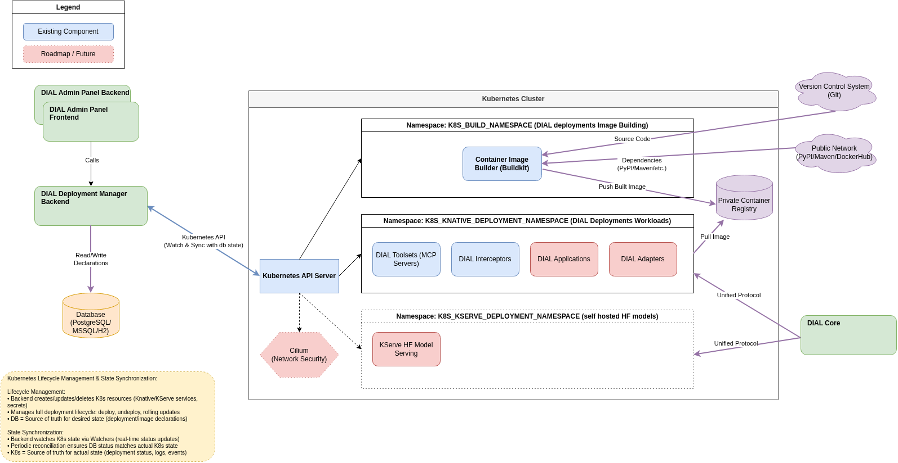

# DIAL Deployment Manager Backend

[](https://www.oracle.com/java/technologies/javase/jdk21-archive-downloads.html)
[](https://spring.io/projects/spring-boot)
[](LICENSE)

Backend service module that extends the [AI DIAL Admin Panel](https://github.com/epam/ai-dial-admin-backend), simplifying and democratizing the building and deployment of AI applications and deployments inside Kubernetes. This service is deployed alongside the main admin app and is used by both the admin backend and frontend (feature-flagged).

The DIAL Deployment Manager Backend makes complex Kubernetes-based AI deployments accessible without requiring deep Kubernetes expertise. It provides a streamlined interface for managing container image builds, deployments, and lifecycle operations for AI workloads.

**Supported workloads:**

| Workload | Runtime | Source |
|---|---|---|
| MCP (Model Context Protocol) servers | Knative Serving | Image built from Git / Docker image / STDIO wrapper, or an existing image reference |
| DIAL interceptors | Knative Serving | Image definition or image reference |
| DIAL adapters | Knative Serving | Image definition or image reference |
| DIAL applications | Knative Serving | Image definition or image reference |
| Inference models | KServe | HuggingFace model (text-generation, text-classification with an auto-chained transformer) |

For more information about the parent AI DIAL Admin Panel, visit the [ai-dial-admin-backend repository](https://github.com/epam/ai-dial-admin-backend) or [DIAL Documentation](https://docs.dialx.ai/).

## Table of Contents

- [Prerequisites](#prerequisites)
- [Features](#features)
- [Configuration](#configuration)
- [Getting Started](#getting-started)
- [Documentation](#documentation)
- [Architecture Diagram](#architecture-diagram)
- [Security](#security)
- [Spec-Driven Development](#spec-driven-development)
- [Contributing](#contributing)
- [License](#license)

## Prerequisites

- Java 21
- Gradle — use the bundled wrapper (`./gradlew`), no local installation needed
- Docker and Docker Compose (for containerized local runs and for the Postgres/SQL Server test suites)
- Kubernetes cluster with [Knative Serving](https://knative.dev/docs/install/) (all image-based deployments) and, optionally, [KServe](docs/kserve.md) (inference deployments) and [Cilium](https://docs.cilium.io/) (network policies)
- Database: PostgreSQL or SQL Server for production; H2 is sufficient for local development

## Features

**Deployments**
- **Knative-Based Deployments**: Serverless MCP, interceptor, adapter and application deployments with auto-scaling
- **KServe Inference Deployments**: Deploy HuggingFace models with automatic task detection (text-generation, text-classification); text-classification models get a chained KServe transformer
- **Deployment Lifecycle**: Create, deploy/undeploy, duplicate, change image, custom `command`/`args`, probes, startup and periodic state reconciliation with the cluster
- **Node Pools**: Explicit `nodeSelector` / affinity / tolerations per pool, with create-time defaults for regular and model workloads
- **Deployment Metrics**: Live snapshot of replica counts, per-pod CPU/memory, GPU telemetry (NVIDIA DCGM) and normalized vLLM/TGI/SGLang serving metrics
- **MCP Server Introspection**: List tools, resources and prompts of running MCP deployments and call tools
- **Real-Time Status Updates**: Server-Sent Events (SSE) for build logs, deployment status and Kubernetes events

**Images**
- **Container Image Building**: Automated image building with [BuildKit](https://github.com/moby/buildkit) in Kubernetes jobs, supporting both root and rootless modes; in-flight builds can be stopped
- **Image Definition Management**: MCP, interceptor, adapter and application image definitions with versioning and topics
- **Private Sources**: Private Git repositories (multiple credentials per host, scoped to a repository, group or domain) and trusted private Docker registries
- **Automatic Pull Secrets**: Pull secrets are provisioned and wired into workloads when images come from a credentialed registry

**Integrations**
- **MCP Registry Browser**: Browse and filter MCP servers from the public MCP registry
- **HuggingFace Browser**: Search models and fetch their metadata

**Governance & Operations**
- **Network Controls**: Global domain whitelist restricting network egress of image builds, and optional per-deployment Cilium network policies
- **Auditing & Rollback**: Activity feed and per-resource revision history (Hibernate Envers), with rollback to a past revision
- **Export / Import**: Move deployments and image definitions between environments as a ZIP archive, with previews before export and import
- **Environment Variable Management**: Sensitive environment variables are stored as Kubernetes Secrets and excluded from exports
- **Disposable Resource Management**: Automatic tracking and scheduled cleanup of Kubernetes resources
- **Multi-Database Support**: H2 (development only), PostgreSQL and SQL Server, with Flyway migrations
- **Authentication & Authorization**: Basic auth or OIDC/JWT (Azure AD, Keycloak, Auth0, Okta, Cognito), DIAL Core API keys, `FULL_ADMIN` and `READ_ONLY_ADMIN` roles
- **Observability**: Health endpoint, Prometheus metrics, OpenTelemetry traces/logs/metrics export

## Configuration

Complete list of configuration properties can be found in the [Configuration Documentation](docs/configuration.md).

### Key Configuration Areas

- **Kubernetes Connection**: Configure via config file (`K8S_CONNECT_TYPE=CONFIG_FILE`) or token-based authentication (`K8S_CONNECT_TYPE=TOKEN`)
- **Docker Registry**: Configure registry URL, protocol, and authentication (`DOCKER_REGISTRY`, `DOCKER_REGISTRY_AUTH`)
- **Database**: Support for H2, PostgreSQL, and SQL Server via `DATASOURCE_VENDOR` environment variable. H2 is the default but is intended for **development and testing only** — its backup/restore procedures are unreliable, so running it in production is very strongly discouraged; use PostgreSQL or SQL Server instead. See [Datasource Configuration](docs/configuration.md#datasource-configuration).
- **Security/Authentication**: Configure via `CONFIG_REST_SECURITY_MODE` (none, basic, oidc)
- **Knative / KServe**: Enable runtimes (`K8S_KNATIVE_ENABLED`, `K8S_KSERVE_ENABLED`), namespaces, timeouts, and scaling parameters
- **Build Pipeline**: Configure build namespaces, images, and resource limits
- **Node Pools**: `NODE_POOLS`, `NODE_POOL_DEFAULT`, `NODE_POOL_DEFAULT_MODEL`

Infrastructure-relevant changes between releases are tracked in the [Infra Changelog](docs/INFRA-CHANGELOG.md), with step-by-step [upgrade plans](docs/upgrade-plans/) for releases that need them.

## Getting Started

### Run Application with Gradle

From the project's root directory:

```bash
./gradlew bootRun
```

### Run with Docker Compose

`local_env/docker-compose.yml` builds the image and starts the application together with PostgreSQL and SQL Server containers (Keycloak is available via the `keycloak` profile). It mounts `~/.kube` so the application can reach your current cluster:

```bash
cd local_env
docker compose up
```

### Run with Docker

```bash
docker build -t aidial/ai-dial-admin-deployment-manager-backend:latest .
docker run -p 8080:8080 aidial/ai-dial-admin-deployment-manager-backend:latest
```

Verify the installation:

```bash
curl -X GET --location "http://localhost:8080/api/v1/health"
```

Expected response:
```json
{
  "status": "UP"
}
```

The OpenAPI UI is available at `http://localhost:8080/swagger-ui/index.html`. A [Postman collection](docs/rest-collection/dm_postman_collection.json) is also provided.

### H2 Database Credentials

For local development with H2 database, default credentials are provided in `local_env/docker-compose.yml`. For details on generating new credentials, see the [Development Guide](docs/Development.md#h2-database-credentials).

## Documentation

| Document | Contents |
|---|---|
| [Development Guide](docs/Development.md) | REST API overview, build/test commands, architecture |
| [Configuration](docs/configuration.md) | All configuration properties and environment variables |
| [KServe Installation](docs/kserve.md) | Installing KServe and the RBAC needed for inference deployments |
| [Full Security Model Deployment Guide](docs/deployment_guide_full_security_model.md) | Dual-cluster (trusted/untrusted) setup with optional Cilium |
| [Infra Changelog](docs/INFRA-CHANGELOG.md) / [Upgrade Plans](docs/upgrade-plans/) | Per-release infrastructure changes and upgrade steps |
| [DB Schema](docs/db-schema.md) | Auto-generated database schema (`./gradlew generateDbSchema`) |
| [Capability Specs](specs/README.md) | Per-capability behaviour and contracts |

## Architecture Diagram



*[Edit diagram](docs/diagramms/infrastructure_component/infrastrucutre-component-diagramm.drawio) in draw.io*

## Security

For information about security practices and reporting security issues, please refer to our [SECURITY.md](SECURITY.md) document.

**Security is disabled for default configuration (`CONFIG_REST_SECURITY_MODE=none`). It's highly not recommended to use default configuration
for production environment.**

For production environment:
- Set `CONFIG_REST_SECURITY_MODE` environment variable with either `oidc` or `basic` value
- (optional) Set `MS_SQL_SERVER_OPS` environment variable with `encrypt=true;` value if application is launched with SQL Server.

`/api/v1/health` and `/api/internal/**` are always unauthenticated; restrict access to the internal endpoints at the network level.

The system supports the following authentication methods:

1. **Basic Authentication**
    - Configure username and password via Spring Boot's standard properties:
      ```properties
      spring.security.user.name=your_username
      spring.security.user.password=your_password
      ```
    - Enable with:
      ```properties
      config.rest.security.mode=basic
      ```

2. **JWT Authentication**
    - Configure Identity Provider settings using environment variables or with the `providers.{provider_name}.*` format.
      Each provider is configured separately (example for Azure Provider):
      ```bash
      # Required properties
      providers.azure.issuer=your_issuer
      providers.azure.jwk-set-uri=your_jwk_set_uri
      providers.azure.audiences=your_audiences

      # Optional properties
      providers.azure.aliases=your_aliases  # Azure-specific
      providers.azure.role-claims=your_role_claims
      ```
    - Enable with:
      ```properties
      config.rest.security.mode=oidc
      ```
    - Supported providers: azure, keycloak, auth0, okta, cognito
    - Map IdP roles to application roles (`FULL_ADMIN`, `READ_ONLY_ADMIN`) with `SECURITY_ROLES_MAPPING` or per provider with `providers.*.roles-mapping`.

3. **DIAL Core API Key** (in `oidc` mode)
    - Set `API_KEY_ENABLED=true` and `API_KEY_CORE_URL` to accept the `Api-Key` header; keys are validated against DIAL Core's `/v1/user/info`.

See [Security Configuration](docs/configuration.md#security-configuration) for complete details.

### Keycloak

Keycloak can be used as a simple IDP replacement for local test/development (`docker compose --profile keycloak up` in `local_env`).
Please refer to the [Keycloak setup guide](https://github.com/epam/ai-dial-admin-backend/blob/development/docs/keycloak_configuration.md) for more information.


## Spec-Driven Development

This project uses [spec-kit](https://github.com/github/spec-kit) for spec-driven development. AI agents follow the project constitution and structured specs to ensure every feature aligns with architectural principles.

### Developer Setup

Requires Python 3.11+ and [`uv`](https://docs.astral.sh/uv/).

```bash
uv tool install specify-cli --from git+https://github.com/github/spec-kit.git
```

### Workflow

| Command | Purpose |
|---|---|
| `/speckit.constitution` | View or amend the project constitution (`.specify/memory/constitution.md`) |
| `/speckit.specify <description>` | Create a new feature spec in `specs/N-name/spec.md` on a new branch |
| `/speckit.plan` | Generate a technical plan (`plan.md`) from the current spec |
| `/speckit.tasks` | Break the plan into an implementation checklist (`tasks.md`) |
| `/speckit.implement` | Execute all tasks in order |
| `/speckit.clarify` | Ask structured questions to de-risk ambiguous requirements |
| `/speckit.analyze` | Cross-artifact consistency check before implementation |
| `/speckit.checklist` | Generate quality checklists for the plan |

Feature specs land in `specs/N-feature-name/`; long-lived per-capability specs live in `specs/<capability>/spec.md` (index in [specs/README.md](specs/README.md)). The constitution is at `.specify/memory/constitution.md`.

## Contributing

We welcome contributions! Please see our [Contributing Guide](CONTRIBUTING.md) for details.

For detailed information on how to contribute, see the full [contributing documentation](https://github.com/epam/ai-dial/blob/main/CONTRIBUTING.md) from the parent project.

## License

This project is licensed under the Apache License 2.0 - see the [LICENSE](LICENSE) file for details.
